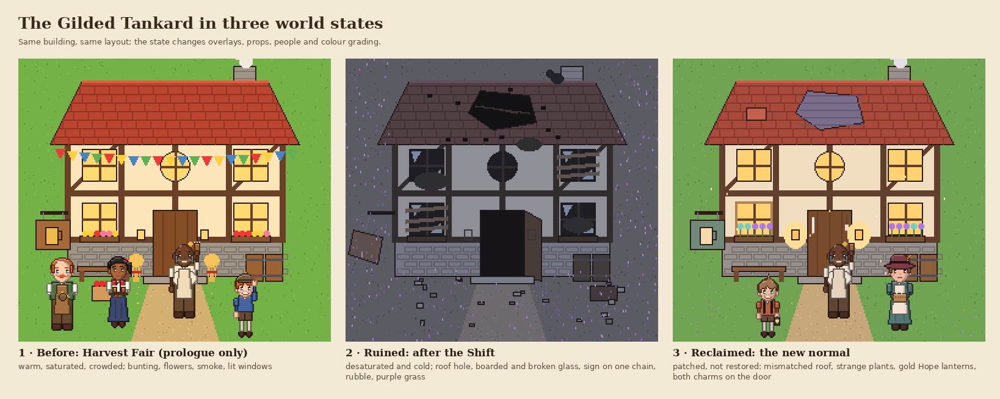
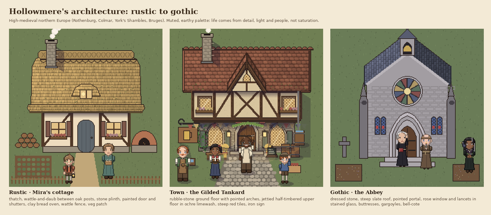
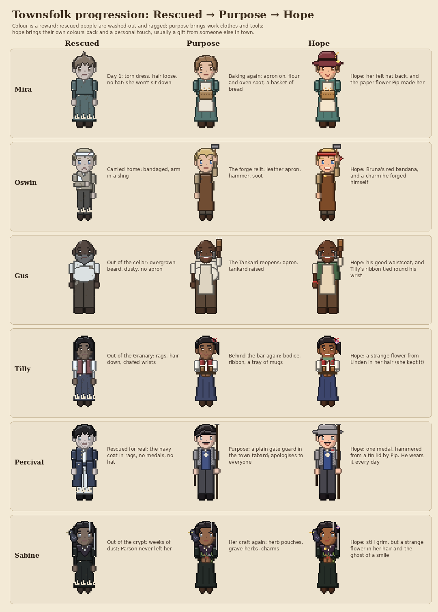

# Art plan (draft)

## 1. Style guide (to lock early)
| | Proposal |
|---|---|
| Tiles | **16×16 px** (Stardew scale). Graveyard Keeper's denser detail costs a lot more per asset. |
| Characters | **16×32 px**, 4 directions: idle, walk, tool use; fighters also get attack, dodge, hurt and death. |
| Enemies | Same scale, with **clear wind-up frames** (combat is harder, so attacks must be readable). |
| Portraits | **256×256 px** for dialogue (needed for readable eyebrows and expressions), 3–4 expressions. **Main cast only** at first (you, Mira, Pip, Wren, Oswin, Aldous, Percival, Winnie). Portraits have finer pixels than the world sprites; that's a common, deliberate choice for dialogue UI. |
| Palette | One **limited palette** (32–64 colours, e.g. from Lospec) for the whole game, so assets from different sources look like one game. |
| Mood | Warm, cozy colours in town; purple and wrong-feeling colours outside the walls; gold for Hope. |
| Lighting | Unity URP **2D lights**: day/night, lanterns, Pip's window, the Hope glow drifting down the roots. Lighting does a lot of the mood for cheap. |

## 2. Where the art comes from: in phases
1. **Prototype: placeholders and asset packs.** Squares, or ready-made packs. Good fits:
   - *Kenney* (kenney.nl): free CC0 packs such as Tiny Town / Tiny Dungeon. Fine for grey-boxing.
   - *Mana Seed* (Seliel the Shaper, itch.io): farming-RPG packs very close to the Stardew look, with a paper-doll character system; paid, commercial use allowed (check the licence of each pack).
   - Other cozy farming packs on itch.io. **Always check the licence** (some free packs are non-commercial only).
2. **Style target: commission a pixel artist** for one small, finished scene: the starting area, You + Mira + Pip, one Roots tunnel with a goblin. This sets the look everyone else follows and becomes the first screenshots.
3. **Production:** that artist (or 2–3 artists working from the style guide) makes the rest. Packs can stay for background props if they match the palette.
4. **Key art / Steam capsule:** commissioned separately (often a painted illustration, not pixel art). It's the single most important image for wishlists.

## 3. Options and honest trade-offs
| Route | Pros | Cons |
|---|---|---|
| Asset packs | Cheap, instant | Other games use them too; harder to look unique; may not cover strange-world things (metal vines, hope glow, the DM). |
| Hire pixel artist(s) | Unique, consistent, professional | The biggest cost of the project. A Stardew-scale game needs thousands of sprites and animation frames. Get quotes; rates vary hugely. |
| Draw it yourself (Aseprite) | Free, full control | Slow; ConcernedApe spent years on Stardew's art. Fine if you enjoy it. |
| AI-generated art | Fast concepts and mood boards | Pixel output is usually inconsistent (no clean pixel grid, drifting palette), needs heavy cleanup; **Steam requires disclosing AI-generated content**; cozy/indie players can react badly. Best kept to early concepts. |

**Recommendation:** packs for the prototype → commission a style-target scene once the prototype is fun → artist(s) for production, with key art commissioned separately.

## 4. Asset list for the Day 1 prototype / vertical slice
- **Tiles:** grass, dirt, path, purple strange grass, rubble, fences, town wall, Postern gate, the small Strange Garden (soil + blessed border), Old Graveyard (prologue), Roots tunnel (dirt walls, roots, metal vines).
- **Buildings:** your house and Mira's house (outside + inside), ruined buildings as backdrops.
- **Characters:** You (walk, hoe, water, carry, sword swing, dodge), Mira, Pip, Sprout, Wren (walk + fight), Oswin (in bed), Percival (prologue), the Dungeon Master (shadow/silhouette).
- **Enemies:** 2 goblin types, a root creature, wraith, zombie, skeleton.
- **Crops:** 2–3 normal + 2 strange crops, 4–5 growth stages each.
- **Items/icons:** ~40 (tools, seeds, crops, food, bandages, lantern...).
- **UI:** energy, Hope meter, health/stamina, inventory, dialogue box, 4–5 portraits.
- **Effects:** Hope glow, lantern light, hit flashes, dust, the green flash of the Shift.

## 5. Concept sprites
- **Mira Wainwright:** [preview](concept-art/mira/mira_preview.png) · [walk GIF](concept-art/mira/mira_walk.gif) · Unity-ready sheets: [walk 16×32](concept-art/mira/mira_walk_16x32.png) (rows: down, left, right, up; columns: idle, step, step) and [portraits 64×64](concept-art/mira/mira_portraits_64.png) (neutral, stern, soft).
  Generated by [tools/concept_art/mira.py](../tools/concept_art/mira.py). **Concept quality**: a style and colour reference for an artist, not final art.
- **Mira, higher resolution (current look):** **light brown** hair parted in the middle and tied back in a low bun with loose strands, **brown eyes**, plain teal dress (no belt), felt hat with a wheat sprig **outdoors**, **hatless indoors**, apron **once she decides to cook again**. [Preview](concept-art/mira/mira_hd_preview.png).
  - Outdoors: [walk GIF](concept-art/mira/mira_hd_outdoor_walk.gif) · [walk 32×64](concept-art/mira/mira_hd_outdoor_walk_32x64.png) · [portraits](concept-art/mira/mira_hd_outdoor_portraits_256.png)
  - Indoors: [walk GIF](concept-art/mira/mira_hd_indoor_walk.gif) · [walk 32×64](concept-art/mira/mira_hd_indoor_walk_32x64.png) · [portraits](concept-art/mira/mira_hd_indoor_portraits_256.png)
  - Outdoors, cooking: [walk 32×64](concept-art/mira/mira_hd_outdoor_apron_walk_32x64.png) · [portraits](concept-art/mira/mira_hd_outdoor_apron_portraits_256.png)
  - Indoors, cooking: [walk 32×64](concept-art/mira/mira_hd_indoor_apron_walk_32x64.png) · [portraits](concept-art/mira/mira_hd_indoor_apron_portraits_256.png)
  - Generated by [tools/concept_art/mira_hd.py](../tools/concept_art/mira_hd.py). (The 16×32 version above still shows her older kerchief + apron look.)
  - **Rule this sets for all characters:** outfits swap by context (outdoors/indoors) and by story state (e.g. Mira's apron), so each character needs a few sprite-sheet variants, not just one.

**Resolution choice (open):** 16×32 (Stardew scale) vs **32×64** (closer to Graveyard Keeper's detail). 32×64 has 4× the pixels per frame, so every character, animation and tile costs noticeably more to draw. If we go 32×64, tiles become 32×32 and the Pixel Perfect Camera reference resolution doubles (e.g. 960×540).
- **Pip Wainwright (7):** light brown hair from Mira (messy, with a cowlick), green eyes from Edric, freckles, ears that stick out a little; rust tunic with a mended tear, suspenders, knee breeches, grey socks. [Preview](concept-art/pip/pip_preview.png) · [walk GIF](concept-art/pip/pip_walk.gif) · [walk 32×64](concept-art/pip/pip_walk_32x64.png) · [portraits 256×256](concept-art/pip/pip_portraits_256.png) (happy, curious, worried). Generated by [tools/concept_art/pip.py](../tools/concept_art/pip.py).

## 6. World states: before, ruined, reclaimed

Concept: [tankard_states.png](concept-art/world/tankard_states.png), generated by [tools/concept_art/world_states.py](../tools/concept_art/world_states.py).

**Three big looks:**
1. **Before (Harvest Fair):** the liveliest the town will ever look. Warm and saturated; bunting, flowers, smoke, lit windows, crowds. **Only needed for the prologue**, so only the prologue's slice of town (the Tankard, the Square, your street, Mira's house) gets this state.
2. **Ruined (after the Shift):** desaturated and cold. Roof holes, broken and boarded windows, the Tankard's sign hanging by one chain, rubble, purple strange grass creeping in, no smoke, no people.
3. **Reclaimed (the new normal):** lively again, but **patched, not restored**. Mismatched new shingles, fresh wood next to old, strange plants in the window boxes, gold Hope lanterns, the Abbey's ribbon *and* Sabine's charm on the same door. The town changed with the world; it never goes back to exactly how it was.

**Don't draw three copies of every building.** Draw one base and switch layers:

| Layer | Before | Ruined | Reclaimed |
|---|---|---|---|
| Base building (walls, roof, doors) | ✓ | ✓ (darker variant or grading) | ✓ |
| Damage overlay (roof hole, broken glass, scorch, hanging sign) | | ✓ | |
| Repair overlay (boards, patched roof, new frames) | | (boards) | ✓ |
| Decor (bunting, flowers, wheat / strange plants, charms) | festival set | | new-normal set |
| Props (barrels, benches, crates / rubble) | ✓ | rubble set | ✓ |
| Lights (windows, lanterns, Hope glow) | warm | off | warm + gold |
| Colour grading | warm, ~80% saturation | cold, ~30% saturation | neutral-warm, ~70% saturation |
| People, smoke, birds, cats | many | none | grows with population |

**Per-building progress between states:** Ruined → **Cleared** (rubble gone) → **Patched** (boards, temporary roof, people can use it) → **Reclaimed** (decorated, lit) → optional **Upgrades**. Each step is an overlay toggle, usually one or two new sprites, not a new building.

**Liveliness follows Hope** (see GAME_DESIGN.md §24): saturation, light warmth, chimney smoke, birds, laundry lines, music layers and how many people are out all rise with the town's Hope and population.

**In Unity:** a building prefab with stacked SpriteRenderers (Base / Damage / Repair / Decor / Lights) switched by a `BuildingState` value; one ScriptableObject per building listing its sprites per state; a URP Volume (Color Adjustments: saturation, colour filter) blended by Hope; 2D lights for windows and lanterns; particle systems for smoke and Hope motes.

## 7. Architecture style

**Period and feel:** high-medieval northern Europe (roughly 1150–1450): **a little gothic, a little rustic, lively**. References: Rothenburg ob der Tauber, Colmar, York's Shambles, Bruges, Tallinn's old town, Normandy half-timbering.

**The range, from humble to grand:**
| | Rustic (cottages, farms, the mill) | Town (inn, shops, houses) | Gothic (Abbey, Counting House, gatehouses, Arcanist's tower) |
|---|---|---|---|
| Walls | wattle-and-daub between oak posts, stone plinth | rubble-stone ground floor, **jettied** half-timbered upper floor in coloured limewash | dressed (ashlar) stone, buttresses |
| Roof | thick thatch, moss | **steep** red clay tiles, front gables, iron finials | steep slate, bell-cote / spire, pinnacles |
| Openings | small square windows, painted shutters, round-topped plank door | **pointed arches** on the ground floor, leaded diamond-pane casements upstairs | great pointed portal, rose window, stained-glass lancets |
| Details | woodpile, bread oven, wattle fence, veg patch | wrought-iron sign bracket, flower boxes, hops garland, rain barrel, chalkboard | gargoyles, carved stone cross, herb beds |

**Muted, not garish (Graveyard Keeper, not a cartoon):** the palette is earthy and slightly desaturated: olive grass, weathered terracotta, oat-coloured limewash, grey-green and slate-blue paint, dusty reds. Liveliness comes from **detail, warm light, smoke, flowers, bunting and people**, not from saturated colour. Even the Harvest Fair (the brightest the town ever looks) stays muted; the ruined state drops to near-grey; the reclaimed state sits in between.

**Detail and shadows (the Tankard is the reference):** light comes from the **top left**. Every protruding thing casts a soft shadow down and to the right:
- eaves shadow on the upper wall, a deep shadow under the jetty, shadows under brackets, sills and flower boxes;
- recessed window and door reveals (top and left edges in shade), a reflection streak on the glass;
- shutters, barrels, benches, troughs and people all get contact shadows; the building throws a shadow on the ground to the right;
- texture everywhere: limewash mottling, wood grain with a lit edge on every post, tile highlights and colour variation, lit tops on stones, moss and ambient occlusion where walls meet the ground;
- warm light pooling under lanterns and on the cobbles.
Shadows use a translucent dark purple, never flat black, so they tint whatever is underneath.

**Roofs in top-down 3/4 view** (the rule that makes buildings read correctly):
- A slope that **faces the viewer** is drawn as a **rectangle**, with tile courses running **horizontally**; never a trapezoid that narrows toward the ridge.
- Slopes that **run away from the viewer** (both sides of a front gable, the nave of the Abbey) are **parallelograms**, with courses running **vertically**; the lit side is lighter, the far side darker, with dark valley lines where they meet the main roof.
- Every course casts a thin shadow on the one below; tiles vary slightly in tone; ridge tiles, the fascia under the eaves and the thickness of the gable ends are all visible.
- Chimneys rise out of the slope (lead flashing at the base), with a lit cap, a dark flue and a shadow across the tiles.
- Damage and repairs follow the courses (stepped edges), with rafters and battens visible through holes.
Code: [tools/concept_art/roofs.py](../tools/concept_art/roofs.py).

Generated by [tools/concept_art/world_states.py](../tools/concept_art/world_states.py).

## 8. Character stages

Every townsperson has three looks: **Rescued** (ragged, dirty, ~40% saturation, no tools), **Purpose** (work clothes and tools, ~80%) and **Hope** (clean, mended, full colour, plus a personal accent). Built from the same sprite with overlays (`tatters`, `dirt`, `soot`, `tired`, `patches` / `flower`, `scarf`, `brooch`, `tinmedal`, `wristribbon`) and a saturation step, so it's three cheap variants, not three characters. Generated by [tools/concept_art/stages.py](../tools/concept_art/stages.py).
