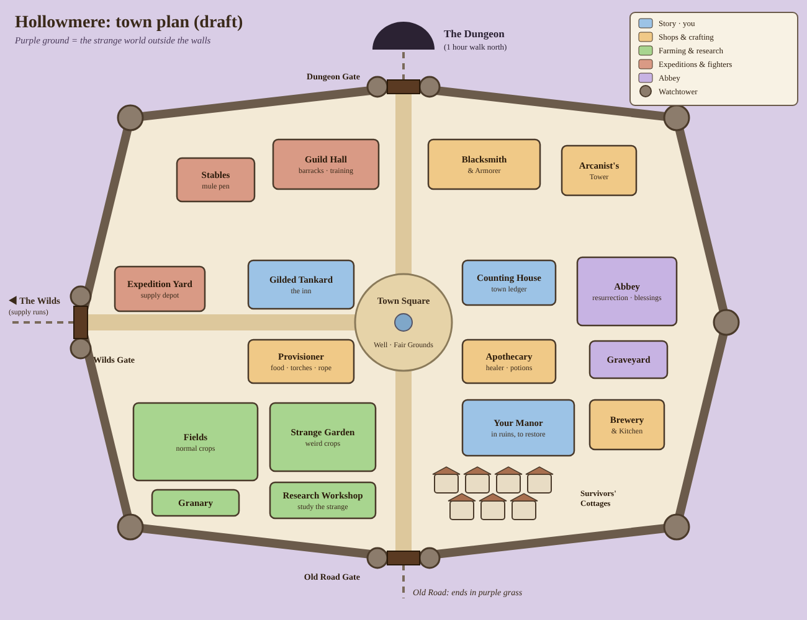
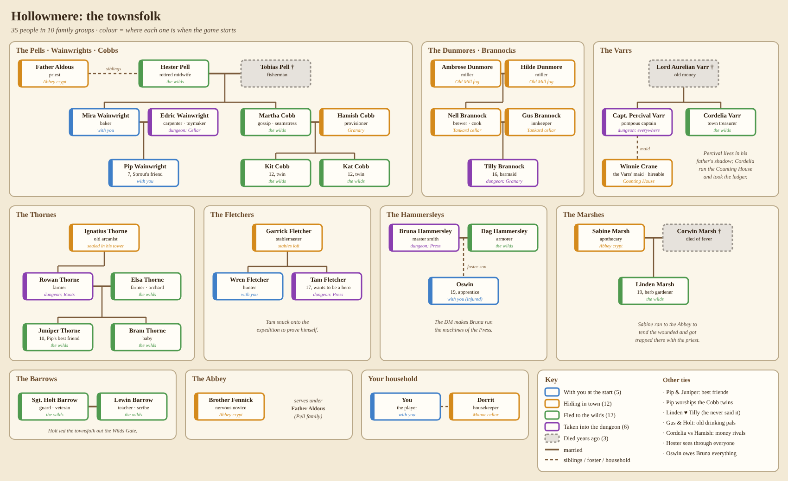

# Adventure Capital — Design Notes (brainstorm v0.2)

> **v0.5 decision: no idle mechanics.** The dungeon is played actively; idle-only parts (offline progress, Standing Orders as AFK play, the tavern strip) are on hold. Sections 2–3 still describe the old idle design and need a rewrite.
>
> **Platform decision:** a premium (buy-once) **Steam** game, no Web3. The Robinhood Chain notes were dropped in v0.2.

> Status: brainstorm. Anything marked **[?]** is an open question to settle together.

## 1. Pitch

A dungeon has opened under the town of **Hollowmere**, and its Dungeon Master's
monsters spill out a little more every night. Everyone is panicking except **you**,
a wealthy resident having an ale at the *Gilded Tankard*. The innkeeper tells you how
bad things are. You smile and say: *"Sounds like a business opportunity."*

You don't fight. You **invest**: hire a warrior, buy him the basics, send him down,
and take your share of whatever he hauls back.

**Genre:** idle / incremental dungeon crawler with an active decision layer.
**Tone:** fantasy with a dry, capitalist sense of humour (the investor stays at the inn; the hero does the bleeding).
**Working title ideas:** *Adventure Capital*, *Dungeon Ventures Ltd.*, *Hired Steel*, *The Delve Dividend*.

## 2. Core loop

```
 INN (meta / hire / contracts)
   │
   ▼
 TOWN ── heal · eat · buy provisions, keys, stones · upgrade gear
   │                                    ▲
   ▼                                    │ walk out or teleport stone
 DUNGEON ── hero walks the tunnel, fights by himself (idle)
   │            you set the stance, react to events (active)
   ├── dies ──► ABBEY: resurrect (time, or gold, or premium)
   └── loot is only BANKED when the hero gets back to town alive
```

**The key tension:** loot the hero is carrying is at risk until he's back in town.
Push deeper for better loot, or go home now and keep what you've got?
That's the push-your-luck engine behind the "non-idle" part.

## 3. The hero in the dungeon

### 3.1 Stances
| Stance | Damage dealt | Damage taken | Descent speed | Loot multiplier | Notes |
|---|---|---|---|---|---|
| Defensive | low | very low | slow | ×0.8 | safe for AFK / offline |
| Normal | base | base | base | ×1.0 | default |
| Aggressive | high | high, **plus HP drain over time** | fast | ×1.5 + crit chance | will kill him if left on; needs retreat or a stance change |

- Aggressive is the way to farm fast, but **you** have to watch it.
- Ideas **[?]**: a *Berserk* stance unlocked later (huge damage, can't retreat), stance-specific skills.

### 3.2 Survival resources
- **HP**: heals in town (healer costs gold) or with potions in the dungeon.
- **Stamina / hunger**: drains as he walks. Provisions (rations, ale, jerky) refill it. At 0 his stats drop and HP regen stops.
- **Light (torches)** **[?]**: optional. Deeper tiers are dark and need torches/lanterns, or the hero is ambushed more often.
- **Keys**: open locked doors (shortcuts, side vaults) and chests.
- **Teleport stones**: instant exit to town with all carried loot. The only safe way out mid-run.

### 3.3 Leaving the dungeon
1. **Walk back**: free, but takes time and the return trip has encounters.
2. **Teleport stone**: instant, costs a stone (bought with gold; rare drops).
3. **Death**: carried loot is lost (all of it, or a percentage **[?]**), the hero goes to the Abbey.

### 3.4 Death and the Abbey
Resurrection options:
- **Wait**: free, long timer (scales with depth or hero level).
- **Donation**: gold, shorter timer.
- **Blessing**: premium currency, instant.
- Ideas: death leaves a **"corpse run"** marker so the next run can try to recover part of the lost loot. Repeated deaths cause a temporary *Shaken* debuff (morale).

### 3.5 Standing Orders (makes the idle part work)
Rules the hero follows when you're not watching:
- "If HP < 30%, switch to Defensive."
- "If HP < 15% and I have a teleport stone, use it."
- "Eat when stamina < 40%."
- "Return to town when bags are full."
Start with 1–2 rule slots; unlock more (the *Quartermaster* upgrade). Offline progress
runs on these rules. Good orders make idle play safe; manual play does better than them.

### 3.6 Active layer (why you check in)
- **Timed events** that fall back to Standing Orders if you're away:
  - Mysterious chest: open it (could be a mimic) or leave it?
  - Fork in the tunnel: shortcut (needs a key) or the long way?
  - Wounded stranger: help (costs a potion, chance of a recruit) or ignore?
  - Ambush: pick a stance for the fight.
- **Boss fights** with phases; switching stance at the right time makes a big difference.
- **Rally / Cheer** button on a cooldown (a messenger raven from the investor) for a short buff.
- Optional: tap to land crits / parry windows **[?]** (risky: can turn the game into a clicker).

## 4. Town

Each building is a shop and an upgrade track. Many start **closed** because of the
monster threat and reopen as you clear tiers, so the town visibly comes back to life.

| Building | Function |
|---|---|
| **Gilded Tankard (Inn)** | Story, hiring, contracts/bounties, innkeeper hints. Your HQ. |
| **Blacksmith** | Weapons; upgrade/reforge. |
| **Armorer** | Armor, shields. |
| **Apothecary / Healer** | Healing in town, potions, antidotes. |
| **Provisioner** | Food, ale, torches, rope. |
| **Locksmith** | Keys, lockpicks. |
| **Arcanist** | Teleport stones, enchantments, scrolls. |
| **Abbey** | Resurrection, blessings, curse removal. |
| **Counting House** | Your ledger: income, the hero's wages, investments, town bonds **[?]**. |
| **Guild Hall** (later) | Hire more adventurers and classes; run parties. |

### 4.1 Business layer (the "investor" fantasy)
- The hero takes a **cut** (wage % or a fixed fee per run). Pay him badly and his morale/loyalty drops.
- **Reinvest** profits into shops (discounts, better stock) and town defences.
- **Town Threat meter:** if no one pushes the dungeon, monsters raid the town (shops close, prices go up). Pushing deeper lowers the threat. A soft meta clock that gives the idle game some stakes.
- Later: a roster of several heroes on different floors, and hero classes (Rogue for traps/keys, Cleric for sustain, Mage for AoE).

## 5. The Dungeon: tiers and look

**View:** a 2D side-on tunnel. The hero walks left to right and enemies come in from the right.
Parallax layers (back wall, mid props, foreground beams/roots), HP bars, floating damage numbers.
Every tier changes the wall tileset, lighting, props, music and enemies.

| Tier | Name | Walls / look | Enemies | Boss (DM's lieutenant) |
|---|---|---|---|---|
| 1 | **Goblin Warrens** | dirt tunnels, roots, wooden supports, torches | puny goblins, giant rats, kobold slingers | *Gnashgut the Goblin Chief* |
| 2 | **Forgotten Crypts** | cut stone, cobwebs, sarcophagi, candles | skeletons, ghouls, crypt bats | *The Bone Warden* |
| 3 | **Fungal Depths** | wet rock, glowing mushrooms, spore haze | myconids, cave spiders, trolls | *Mother Mycelia* |
| 4 | **Drowned Mines** | flooded shafts, rusted rails, lanterns | drowned miners, eels, rust golems | *The Foreman* |
| 5 | **Obsidian Forge** | basalt, lava channels, chains | fire imps, salamanders, magma golems | *Forgemaster Kragg* |
| 6 | **Abyssal Cathedral** | bone-and-black-marble, red glow | demons, cultists, nightmares | *The High Inquisitor* |
| ∞ | **The Dungeon Master's Sanctum** | shifting, "game-board" walls | everything; the DM changes the rules | **The Dungeon Master** |

- **Structure:** each tier has ~10 floors; floor 5 is a mini-boss, floor 10 the tier boss. Beating a boss unlocks a **waystone checkpoint** you can teleport to (costs a stone).
- **Flavour idea:** the Dungeon Master is a showman who "narrates" and taunts your hero (and you, the investor) through the walls. Later he starts *adjusting the dungeon* in response to your strategy (more traps if you farm aggressively, etc.).
- After the finale: **prestige** (the DM "rebuilds the dungeon" deeper and harder; you keep some permanent bonuses).

## 6. Items and progression
- **Gear slots:** weapon, offhand, head, body, legs, boots, trinket ×2.
- **Rarity:** common / uncommon / rare / epic / legendary. Affixes like *+lifesteal*, *+loot find*, *aggressive stance drain −20%*.
- **Hero level and skills:** small passive tree (Endurance, Brutality, Survival, Greed).
- **Investor upgrades** (permanent, account-wide): bag capacity, Standing Order slots, shop discounts, offline-progress cap.

## 7. Currencies (Steam version)
| Currency | Source | Use |
|---|---|---|
| **Gold** | loot sold in town | everything day to day |
| **Abbey Favor** | boss kills, achievements, deep floors (earned only, not bought) | instant resurrect, rerolls, rare shop stock |
| **Renown** (prestige) | prestige resets | permanent investor upgrades |

The death cost is time, gold, or Favor the player has earned. **No real-money microtransactions**; if anything,
cosmetic DLC or an expansion tier later.

## 8. Steam: what changes
- **Business model:** premium, roughly $5–15 price range **[?]**. Demo / Next Fest build with Tier 1 to build wishlists.
- **Idle on desktop:** many Steam idlers (*Melvor Idle*, *Idle Champions*, *Nodebuster*, *Rusty's Retirement*) are played in a small window **or docked at the bottom/side of the screen** while you do something else. Idea: a **"tavern window" mode**, a thin always-on-top strip that shows just the tunnel and the HP bar. That suits a game where you watch a hero walk a horizontal tunnel very well.
- **Offline progress:** computed from timestamps on launch, capped (upgradeable). Single-player, local saves, so cheating doesn't matter much; no server needed.
- **Steam features:** achievements (boss kills, "never died in Tier 2", "won a fight on Aggressive with 1 HP"), Cloud saves, Steam Deck verified (the menus need to work with a controller), trading cards later.
- **Leaderboards [?]:** "deepest floor this week", "most gold banked in one run". A weekly **"Dungeon Master's Challenge"** with a fixed seed and modifiers is good for replay value and streams.
- **Hero memorial / "service record":** what the NFT idea did, but just as fun: a wall in the inn for retired and fallen heroes with their stats and how they died.

## 9. Tech sketch (proposal)
- **Engine options:**
  - **Godot 4**: free, great at 2D, exports to Windows/Linux/macOS/Steam Deck, has GodotSteam for Steam integration. **Recommended.**
  - Unity: fine, but heavier for a 2D idle game.
  - Web stack (TypeScript + Phaser/PixiJS) packaged with Electron/Tauri: fast to prototype and fine for idlers, but larger builds and more work on the Steam integration.
- **Deterministic combat sim** (seeded RNG, fixed tick) kept separate from rendering. The same code runs live, in fast-forward for offline progress, and in balance-testing scripts.
- **Data-driven content:** enemies, items, tiers and events in JSON/resources so balancing doesn't need code changes.
- **Art:** pixel art, ~16–32 px characters, one tileset and enemy pack per tier. Start with placeholders.

## 10. MVP / vertical slice (proposal)
1. Town with Inn, Healer, Provisioner, Blacksmith, Abbey (simple menus).
2. One hero, warrior class, 3 stances, HP/stamina, teleport stones, death and resurrection.
3. **Tier 1 only** (Goblin Warrens, 10 floors, Gnashgut boss), side-scrolling tunnel scene.
4. 2 Standing Order slots, offline progress.
5. 3–4 timed events.
6. Save/load. No Steam integration yet; that comes with the demo build.

## 11. Open questions for us
1. Engine: Godot (recommended), Unity, or a web stack wrapped for Steam?
2. Window: a normal window plus a docked "tavern strip" mode, or only one of them?
3. One hero at the start, or a roster early on? When do other classes unlock?
4. On death, lose all carried loot or a percentage?
5. Art direction: pixel art (which resolution?) or hand-drawn 2D?
6. How "active" should it be: decisions only, or also timing/parry mechanics?
7. Run length: how long is a typical dive? (proposal: 5–15 min active, hours on Standing Orders)
8. Is the Dungeon Master a talking character with lots of dialogue, or mostly in the background?
9. Does the town's Threat meter ever actually punish you (raids that close shops), or is it only flavour?
10. Names: the town, the inn, the starting warrior, the game.

## 12. Competitors and references

| Game | Closest overlap | What to learn / how we differ |
|---|---|---|
| **Soda Dungeon 1 & 2** | **Closest match.** A tavern recruits adventurers, the party auto-fights through a side-scrolling dungeon, you decide when to go home. | Proves the concept. It's a party of throwaway recruits and lighter on decisions; we invest in **one hero**, with stances, Standing Orders and the investor fantasy. |
| **Moonlighter** | You keep loot only if you get out; you pay to teleport out (the pendant); run the shop in town. | Same loot-at-risk loop and teleport-stone idea. It's an action game, not idle. |
| **Loop Hero** | Hero runs a route by himself; retreating early keeps more resources than dying. | Their split (keep everything at camp, 60% on retreat, 30% on death) is a good reference for our death-loss rule. |
| **Darkest Dungeon** | Hire heroes in town, push your luck or retreat, upgrade the hamlet, a narrator who comments on everything. | The narrator is a model for the Dungeon Master's voice. Not idle; we're lighter and funnier. |
| **Melvor Idle** | Buy-once Steam idle game; combat with food, auto-eat, gear progression. | Steam idle players accept deep systems and spreadsheets. Its auto-eat upgrade is a simple version of our Standing Orders. |
| **Idle Slayer** | Side-scrolling hero, idle with active bursts. | Very close to the look we want; the active part there is reflexes, ours is decisions. |
| **Idle Champions of the Forgotten Realms** | Idle fantasy party, the biggest name in the genre on Steam. | Free-to-play with heavy monetisation; we're buy-once, single hero, story-driven. |
| **Rusty's Retirement** (+ desktop pets like Bongo Cat) | Docked idle game in a strip of your desktop. | Shows the "tavern strip" docked-window mode can sell. |
| **Shop Titans / Recettear** | You profit from adventurers as a shopkeeper. | Similar "businessman, not hero" fantasy. |

**Our edge (draft):** a single hero you're invested in; three stances plus loot that's at risk until he's home (push your luck); Standing Orders as a light way to program the hero; a dockable tunnel window; a town that comes back to life; investor humour and a talking Dungeon Master.

## 13. Inspirations and the cozy direction (v0.3)

Reference games the player loves: **Majesty**, **Dungeon Siege**, **Stardew Valley**, **Graveyard Keeper**.

### 13.1 From Majesty: indirect control and gold that flows back to you
- In Majesty you never command heroes. You place **bounty flags** and they decide for themselves, depending on personality and greed.
- Heroes **spend their pay in your town's shops**, so you earn it back. That's exactly the investor fantasy: hire, equip, take a cut, and then sell the hero his own potions.
- Ideas:
  - **Bounty board** at the inn ("100g for Gnashgut's head", "50g per goblin ear").
  - **Hero personality** (brave, greedy, cautious, drunk) decides how well he follows your stance and Standing Orders. A greedy hero ignores retreat orders when there's a chest nearby.
  - Later, a **roster** of heroes with Majesty-style classes who choose their own bounties.

### 13.2 From Dungeon Siege: fun to just watch
- The fun is **watching** them fight: readable combat, visible gear on the character, satisfying hits, loot popping out.
- **Pack mule**: a donkey that follows the hero and carries the loot. Bag capacity is literally the mule. Upgrade or name the mule; if the mule dies or panics, the loot is dropped. The mule could walk loot back to town by itself (an alternative to teleport stones).
- Every new item you buy **shows on the hero's sprite**.
- The world feels continuous: the tunnel goes deeper without loading screens and the walls change as you descend.

### 13.3 From Stardew / Graveyard Keeper: the cozy "non-idle" loop
**Big idea:** the active part of the game is **your own life in town** while the hero idles in the dungeon. You actually walk around Hollowmere as the investor.

- **Your stuff:** a house or a run-down manor you restore, and a **brewery / kitchen / garden** where you make the provisions and ale the hero eats (cheaper and better than buying them).
- **Townsfolk with relationships:** the innkeeper, the blacksmith, the abbess, the locksmith's apprentice. Gifts and favours unlock discounts, recipes and side quests. Heart events.
- **Day/night cycle:** the hero works in the dungeon while you work in town. At **night** monsters get bolder (more Threat in town, better loot down below).
- **Graveyard Keeper's dark humour** fits the cynical-investor tone perfectly: you profit from a disaster, and the Abbey charges for resurrections.
- **Seasons / festivals:** a Harvest Fair, the "Day of the Fallen Heroes", a festival when you beat a dungeon boss. The town decorates as it recovers.
- **Restoring the town** = Stardew's community center: shops reopen (blacksmith, arcanist, guild hall) as you clear tiers and invest.
- **Fixed-camera window**: you can always see the hero in the dungeon in a frame (a picture-in-picture "tavern scrying glass"), so you watch him while you farm.

### 13.4 What this changes
- The game moves from "idle with menus" to a **cozy town sim plus idle dungeon**. It's more original and fits the Steam cozy audience (which is large), but it's **much bigger to build**.
- How do we keep the idle part meaningful? Proposal: in-game days are short (~10–15 real minutes), and the hero's progress and your town progress feed each other (his loot → your crafting materials; your food/ale → his buffs).
- Offline: the hero keeps working on Standing Orders, but the town (your crops, your brewery) doesn't progress, or only partly.

### 13.5 Open questions (cozy direction)
1. Does the player walk around town in top-down Stardew style while the dungeon is shown side-on in a window? Or is the whole thing side-on?
2. How much farming/crafting do we want: a small garden + brewery, or a full Stardew-size crafting system?
3. One hero you're attached to (Dungeon Siege), or many heroes acting on their own (Majesty)? Or one hero at first and the Majesty system later?
4. Real-time idle (progress while the game is closed) vs. in-game days (like Stardew)? Both together is possible but needs careful design.

## 14. Story draft (v0.4)

> **Partly superseded by section 16 (v0.7):** a separate arrogant leader leads the expedition and dies, almost everyone else in town is dead, and you come home through the Old Graveyard.

### 14.1 One-line premise
*One night the whole town of Hollowmere is pulled into a strange, hostile world. You lead everyone into the nearby dungeon to end the threat quickly, get ambushed, and come home to ruins. Now you rebuild, slowly and properly.*

### 14.2 Prologue (playable intro, ~10 minutes)

**Beat 1: An ordinary evening.**
Harvest Fair night in Hollowmere. You're the town's richest and proudest resident, enjoying an ale at the *Gilded Tankard*. Short tutorial: walk around, talk to a few townsfolk (the innkeeper, the blacksmith, the abbess, a kid). Just enough that you'll miss them later.

**Beat 2: The Shift.**
A green flash and a deep hum. In the morning the fields end in purple grass, the sky has the wrong colour, and the forest whispers.
> **Innkeeper:** "The road's gone. The *river's* gone. Where in the Nine Hells are we?"

**Beat 3: The hole.**
Scouts find a huge cave mouth an hour's walk away. At night things crawl out of it and scratch at the fences.
> **Innkeeper:** "Every night there's more of them. We won't last a month."
> **You** *(smiling)*: "Then we don't wait a month. We go in, we end it, and we're home by supper."

**Beat 4: The expedition.**
You gather everyone who can hold a pitchfork. A short, easy fight with goblins at the entrance makes the player feel strong.

**Beat 5: The ambush.**
The tunnel goes dark. A huge, amused voice:
> **Dungeon Master:** "Baa-aaa. Look at the little shepherd, taking his whole flock for a walk... and leaving the gate wide open."

Monsters pour in from all sides. People get hurt and scattered; some are dragged into the dark. You barely escape with a few others.

**Beat 6: Ruins.**
Back home, the town is smoking. Doors are broken in, the fields are trampled, the Tankard's sign hangs from one nail. The innkeeper sits on the steps.
> **Innkeeper:** "They came while we were gone. Every last one of us was gone."
> **You:** "...Then we start again. Properly this time."

**Gameplay begins:** a tent, a campfire, one plot of strange soil, and a list of missing names.

### 14.3 The acts (main story)
| Act | Name | What happens | New mechanics |
|---|---|---|---|
| 1 | **Ashes** | Clear the rubble, find survivors hiding in town and nearby, plant the first crops (normal + strange), patch the fence. | Farming, building, research, survivors as workers |
| 2 | **Supply Runs** | Send survivors out into the hostile world. Discover the **ruins of other towns** the Dungeon Master pulled here before you. | Expeditions (idle), map, new materials and recipes |
| 3 | **The Strike** | Send your best fighters to kill the Dungeon Master. **They fail**, but come back with a key piece of knowledge: the dungeon can only be taken **section by section**, and it's weakest **at night**. | Idle dungeon runs with stances, heroes, Abbey |
| 4 | **Night Shift** | You find the **Sleepless Elixir**. Day: run the town. Night: go to the dungeon with your party. Each section you clear, you **wall off and claim** (mushroom farm in the Fungal Depths, a forge in the Obsidian Forge...). | Day/night split, claiming dungeon sections |
| 5 | **The Seal** | Reach the Sanctum, face the Dungeon Master, seal the dungeon for good. | Finale |

### 14.4 Story ideas to keep
- **Most missing villagers are taken, not dead.** Finding them in the dungeon and in the wilds (and the reunion scenes) is a big emotional reward, and much cozier than permanent deaths.
- **Other lost towns:** you are not the first town the Dungeon Master pulled here. Their ruins hold recipes, diaries, tools, and maybe survivors. Mystery: why does he collect towns?
- **The player's arc:** from proud and reckless to a real leader. Keep some vanity for humour; the survivors tease you about the "supper" line.
- **The Sleepless Elixir** should have a light, funny side effect (you start hearing the Dungeon Master's commentary at night, plants grow toward you...).
- **Ending:** the dungeon sealed, and Hollowmere stays in the strange world, because it is home now. Possible secret ending: the way back home opens and you choose.

### 14.5 Keeping it cozy
- Darkness lives in the **story and in the dungeon**; the **town is safe**. Once the walls are up, home is never destroyed again.
- **No permanent loss in normal play:** heroes are resurrected, missing villagers are found, raids at worst damage walls (never crops or homes).
- The prologue does the heavy lifting, then the tone shifts to rebuilding, humour, and small wins.
- References for "dark story, cozy play": *Graveyard Keeper*, *Dredge*, *Spiritfarer*, *Cult of the Lamb*.

## 15. Town plan (v0.6)



Source: [town_map.svg](town_map.svg). The outer line is the town wall, with watchtowers on the corners.

### 15.1 Layout
- **The dungeon is to the south.** *Dungeon Gate* (south), *Wilds Gate* (west, supply runs), *Old Road Gate* (north; the road ends in purple grass), and a small *Postern* (north-east) for soil carts to and from the Old Graveyard.
- **North half = the safe core** you start in: Town Square (your tent next to it at first), Gilded Tankard + Brewery & Kitchen, Counting House, Provisioner, Arcanist's Tower, Research Workshop, Apothecary, Herb Garden, Abbey, Strange Garden, Expedition Yard, Stables.
- **Front line**, just above the barricade: Guild Hall and Blacksmith & Armorer, facing the dungeon side.
- **Houses are scattered all over town**, including inside the locked parcels (survivors may be hiding there).
- **Day barricade:** a palisade across the middle of town. It moves south as you reclaim parcels.

### 15.2 Southern parcels (locked, reclaimed one by one during the day)
| # | Parcel | Side | What blocks it / what you get |
|---|---|---|---|
| 1 | **Overgrown Fields** | SW | Covered in **metal-like vines**. Needs a way to cut or dissolve them (research + blacksmith). Unlocks normal farming. |
| 2 | **Your Manor** | SE | In ruins. Restore it and move out of the tent. |
| 3 | **Granary & Orchard** | SW | Food storage, fruit trees. |
| 4 | **Old Mill** | SE | Unexplored; a mystery. |
| 5 | **Lower Fields** | SW | More vines, plus **wraiths that come out at night**. The big farming area. |
| 6 | **Gatehouse Yard** | SE | Next to the Dungeon Gate. Fortify it before going after the dungeon. |

- **Day:** clear vines, rebuild, farm. **Night:** wraiths come out and you deal with them (defend, or hunt them to make a parcel safe).
- A parcel opens when its blocker is solved: the vines cleared and its wraiths dealt with.

### 15.3 Strange soil and the Old Graveyard
- The town's **Old Graveyard lies outside the walls** (north-east). The strange world has changed its soil; it's the only place that grows the **weird crops**.
- You haul **graveyard soil** into town through the Postern to the **Strange Garden**, next to the Abbey.
- **Never mix strange and normal soil.** The Strange Garden is fenced by a **blessed border** that the Abbey has to consecrate (and maybe renew from time to time). Every load of graveyard soil must be blessed before it comes in.
- Ideas:
  - What happens if they mix (a cart spills, a border fades)? Normal crops mutate, weird weeds spread, or something wakes up. A danger and also a way to discover new crops.
  - Are the night wraiths connected to the graveyard? (Disturbed dead, angry that you're taking their soil?) This would tie the two mysteries together.
  - Abbey upgrades: stronger blessings, a bigger Strange Garden, blessed tools.

## 16. Prologue v2, the starting state, and what blocks the town (v0.7)

### 16.1 Prologue v2
1. **Harvest Fair night**, then **the Shift** (as in 14.2).
2. **The expedition** is led by **Captain Isolde Varr**, arrogant and loud, who takes almost every able-bodied person to "end this before supper". You go along.
3. **The ambush.** The Dungeon Master mocks the Captain ("Baa-aaa... the shepherd took the whole flock for a walk, and left the gate open"). **The Captain dies.** You and a few others break out and run.
4. **The way home goes through the Old Graveyard.** The road to the south gate is swarming, so you circle round through the graveyard outside the walls. Something stirs in the soil. You squeeze in through the **Postern**.
5. **Home.** The town is dead and silent. Only your street, your house, the house next door and a small garden can be reached.
6. **Next door:** a woman and her child are hiding. She asks about her husband. You have to tell her you didn't see him and don't know what happened to him. (He's an open thread for later.)
7. **The injured one:** one of the expedition survivors is badly hurt. You put them in a bed in your house and bandage them as best you can. They can't do anything for a while.
8. **The small garden** behind your house has gone strange. You mark it as the **Strange Garden**. Once it's cleared and blessed (first with a makeshift rite, properly when the priest is found), it grows your first food.
9. Later, **Father Aldous** (once rescued) proposes moving your "whimsical soil experiments" next to the Abbey "so the Lord can keep an eye on them". That's when the proper Strange Garden by the Abbey opens.

### 16.2 Survivors at the start (draft names)
| Who | Role | Notes |
|---|---|---|
| **You** | the player | — |
| **Oswin** | blacksmith's apprentice, **badly injured** | Bedridden at first. Needs medicine + time. When he recovers he **relights the forge**, which is the key to cutting the metal vines. |
| **Wren** | hunter, expedition survivor | Your first able helper. |
| **Mira** and her son **Pip** | the neighbours | Mira's husband **Edric** is missing. Pip is curious about the strange plants. |
| **Father Aldous** | priest | **Not with you at the start.** Trapped in the Abbey crypt; rescuing him unlocks proper blessings. |

Almost everyone else is dead. **New people come later from outside:** survivors of *other* towns the Dungeon Master pulled into this world (found on supply runs). That's how the town fills up again.

### 16.3 What blocks the rest of town: different mechanics, not one grind
**Rules:**
- Every area is blocked by a **different kind** of problem.
- Every unlock gives you **a new verb or system**, not just more space.
- Every area has **one memorable moment** (a reveal, a boss, a person, a story beat). Grind is short; the moment is the reward.
- Blockers chain together: solving one gives you the tool for another.

| Blocker type | How it plays | Example area | What it unlocks |
|---|---|---|---|
| **Rubble** (physical work) | Clear it with tools; heavy pieces need a winch or an animal. Quick, satisfying. | Streets near your house, the Tankard | The Tankard (story hub, cooking) |
| **Injured person** (time + care) | Feed, medicine, bandage changes. A small daily ritual. | Oswin | The forge |
| **Forge / crafting** | Recovered Oswin + materials make tools. | Blacksmith | **Vine cutters**, tools, gear |
| **Metal vines** (research puzzle) | Cutting them normally makes them grow back thicker. Research what kills the roots: forge heat, an acid from a strange crop, or a counter-plant. | Overgrown Fields, Lower Fields | Normal farming |
| **Undead at night** (combat) | Fight wraiths, zombies and skeletons. Light and blessings make an area permanently safe. | Abbey crypt, Lower Fields | **Rescue Father Aldous** → blessings |
| **Locked doors and keys** (exploration) | Find keys out in the world. The Captain's keyring is on her body, back on the road to the dungeon. | Counting House vault, Arcanist's Tower | Money and records; magic |
| **Dungeon Master's glyphs** (riddle) | Seals carved by the DM. Collect fragments of his writing to read them. Lore delivered as a puzzle. | Arcanist's Tower, Gatehouse | Arcane research; story about the DM |
| **Fouled water** (purify) | The town well runs black. Purify it (strange crop + blessing). Until then, water is carried in by hand. | Town Square well | Watering, brewing, the Square |
| **Animal** (tame, don't kill) | A frightened, half-changed ox is loose in the stables. Calm it with food from the Strange Garden. | Stables | A draught animal: heavy rubble, carts, supply runs |
| **Nest** (mini boss) | Something has made a nest in the grain stores. | Granary | Food storage |
| **Strange anomaly** (mystery) | A fog where time behaves wrongly; walking in costs you hours. Find out why. | Old Mill | Mystery payoff, a unique building |
| **Fortify** (build project) | A big multi-stage build, the last stop before the dungeon. | Gatehouse Yard | Ready to take on the dungeon |

### 16.4 Graveyard Unrest: the cost of strange soil
- Every load of graveyard soil you take raises **Graveyard Unrest**. It goes up faster if you take a lot quickly or without safeguards.
- **When Unrest is high**, the dead rise at night: **wraiths** first, then **zombies**, then **skeletons**. They try to get through the Postern and over the wall.
- **Safeguards** that lower Unrest or let you take more soil safely:
  - Blessings from Father Aldous (have to rescue him first).
  - Research: sealing the soil, boundary stones, salt and iron lines.
  - **Tending the graveyard:** reburying disturbed graves, mending headstones, leaving offerings. A quiet, Graveyard Keeper-style chore that calms the dead.
- So pushing hard for weird crops is a choice with a visible cost, which keeps it interesting.

### 16.5 If the soils mix
- If strange soil touches normal soil (a cart spills, a blessed border fades, a flood), **something terrible happens**: the normal crops rot or turn, and the strange growth **spreads tile by tile**. At night something grows out of it.
- **The mystery to solve:** *why* is the graveyard soil like this?
  - Proposed answer: the **metal vines in the fields and the strange graveyard soil are the same thing: the dungeon's roots.** The dungeon is a living thing growing under the town. Graveyard soil has been touched by the roots; mixing it in lets the dungeon grow into Hollowmere.
  - That ties together the vines, the soil, the undead and the dungeon, and gives a long-term goal: find a way to **cut the dungeon off at the roots** (maybe a blessed seed bred from a strange crop).

## 17. Pushback and counter-proposals (v0.8)

### 17.1 Pushback
1. **Scope: this is currently four games.** A cozy farming/crafting sim, a dungeon crawler, a night-defence survival game, and an exploration game (supply runs to other towns), plus a research tree and a mystery. Stardew took one developer ~4 years with *one* of these. We need one spine and everything else in service of it. **Proposal:** the spine is *reclaiming the town*; the dungeon is the late game, the wilds are a light side system.
2. **It's no longer cozy, so we should decide on purpose.** Everyone dead, the widow scene, a dying friend, undead raids and an Unrest meter that sends monsters at your walls: that's survival drama with farming. That's a fine game, but it contradicts the earlier rule "home is safe". Cozy players quit over stress timers and raids that wreck their work. **Proposal:** threats damage *the graveyard and the soil*, or are telegraphed and opt-in; they never destroy what you built.
3. **A dead town has nobody to love.** Cozy games live on their villagers (Stardew has ~30). Four survivors and some later refugees is thin, and refugees are strangers. See idea **B** for a fix.
4. **The player no longer has a stake in the disaster.** When *you* led the expedition, you had guilt and a character arc. Now the Captain made the mistake and died, so you're a passenger. **Proposal:** you were her second-in-command. You had doubts and kept quiet, or you were the one who said "take everyone".
5. **Resurrection breaks the story.** If the Abbey can raise the dead, why not raise the town? We need a rule: maybe resurrection only works if the body is recovered quickly, only inside the walls, or only for someone the graveyard soil "agrees" to return. Or cut it entirely.
6. **An accidental soil mix is a frustration trap.** "A cart spills and something terrible happens" punishes bad luck. **Proposal:** mixing is never an accident. It's a deliberate, dangerous craft (idea **D**).
7. **Eleven blocker types = eleven systems to build.** Variety is right, but each needs art, UI, balance and tutorials. **Proposal:** ~5 systems with different "costumes" (idea **F**).
8. **The Sleepless Elixir solves a problem we no longer have.** It existed so you could run the town by day and the dungeon by night in an idle game. Now night is already busy (undead, graveyard). **Proposal:** replace it with a clean day/night structure (idea **C**).
9. **We lost the most distinctive thing: the hook.** "Rebuild a ruined town after a disaster" is Dragon Quest Builders, Sun Haven, Moonlighter's village, Graveyard Keeper... The smug-investor angle was ours. Idea **A** and **E** bring a distinctive hook back.
10. **We still haven't decided who fights and how.** That decides the engine, the art budget and half the design. It has to be settled before anything else.

### 17.2 New ideas
**A. "You farm the soil. He farms towns."**
The Dungeon Master is a farmer. He pulls towns into this world, lets them grow, and **harvests** them. The ruins found in the wilds are towns he has already harvested. The graveyard soil is his fertiliser; the metal vines are his roots. His "Baa-aaa" was never about the Captain's flock: *the whole town* is his flock. That makes the raids his "harvests", and creates tension because the better your town grows, the more tempting it is to him. One theme ties everything together: you are a farmer who finds out you're also a crop.

**B. The townsfolk's ghosts are your cast.**
The dead of Hollowmere haven't left. They linger, harmless, in their homes and shops: the baker still "kneads" at dawn, the innkeeper still wipes the bar. They're your villagers: you talk to them, learn their stories, do their **unfinished business**, and when you're ready **lay them to rest** in the graveyard (or let them stay as shop spirits who teach recipes). A cozy cast in a dead town. And the stakes are personal: ghosts that are neglected or left unburied for too long slowly **turn into wraiths**. Mira's husband might be among them... or not, which keeps her mystery open.

**C. The Night Choice (instead of the elixir).**
Day = town work (farming, building, people). At dusk you pick **one** thing for the night:
- **Watch** the walls (defend, earn trust).
- **Tend** the graveyard (lowers Unrest, finds things).
- **Delve** into the dungeon (progress, loot, danger).
- **Rest** (full energy tomorrow).
Each choice costs the others. That keeps the day cozy and gives every night one meaningful decision.

**D. The Mixing Bed: dangerous grafting as a feature.**
Mixing soils is a deliberate experiment in a contained, blessed bed. It produces **hybrid crops** with powerful effects (vine acid, Root Sight, a calming fruit for the ox, ghost-visible flowers) but spikes Unrest and can go wrong in visible, telegraphed ways. A risk/reward toy instead of a punishment.

**E. The Dungeon Master's Offers (the business hook, reversed).**
The original pitch had *you* as the smug investor. Now **he** is the smug investor and **you** are his asset. At times he slips a contract under your door: *"I'll clear the vines in the Lower Fields tonight. In return, the graveyard keeps one of your crops."* Shortcuts with a price, all optional, all written down in a **Ledger of Debts** in the Counting House. Refusing is always possible. Accepting too many has consequences in the ending. Great moments for streamers.

**F. One disease, many symptoms: the Roots.**
Every blocked area is blocked by **the same underlying thing**, the dungeon's roots, showing up differently: metal vines in the fields, black water in the well, time fog at the mill, a nest in the granary, undead in the crypt. Each area has a **root node** to find and cut. That gives variety in how it looks and plays, but one system to build and teach. With the hybrid crop **Root Sight**, you can see the roots under the town and plan which area to reclaim next.

**G. Pip's Sketchbook.**
The quest log and bestiary are **Pip's drawings**: crooked crayon pictures of monsters, plants and "things Mr. [you] did today". It changes as he grows braver (or more scared). Cheap to make, very charming, and gives the boy a real role.

**H. The Captain comes back.**
Isolde Varr didn't stay dead. She's one of the dungeon's bosses, **the Shepherdess**, turned by the Dungeon Master. She still has her keyring. Her fight is the payoff of the prologue.

### 17.3 What I'd cut or postpone
- Supply runs / exploring the wilds → postpone to an update; a few scripted trips for the story only.
- Separate systems for each blocker → merge under the Roots (F).
- The Sleepless Elixir → replace with the Night Choice (C).
- Accidental soil mixing → replace with the Mixing Bed (D).

## 18. Core theme: the Hope Farm (v0.9)

### 18.1 Decisions (override earlier notes)
- **Almost no one is dead.** The townsfolk are scattered, hidden or taken, not killed. (Overrides 16.2 "almost everyone else is dead"; drops idea 17.2 **B**, the ghost cast.)
- **Soil mixing causes small problems**, not disasters. (Overrides 16.5.)
- **Night raids cost energy/mood/time; they never send progress back.** (Overrides 16.4's attacks on the walls.)
- **The Dungeon Master farms hope.** He *wants* you to take over the town, rebuild and lead people, because a town full of hope is a crop. Then he harvests it and kills it. **Your goal is to break the chain**: stop him farming the hope and good feelings of the towns he has farmed, including the ones before you.

### 18.2 The twist, told simply
- The Dungeon Master pulls towns into his world. He doesn't want them dead: he wants them **hopeful**. Hope is his crop.
- He picks a **shepherd** to lead each town. The Captain was meant to be Hollowmere's; she was all pride and no hope, so he discarded her in the ambush.
- **He spares you on purpose.** Last line of the ambush: *"Go home, little shepherd. Grow something for me."* The player doesn't understand it yet.
- The ruined towns out in the wilds aren't dead either. Their people are alive but **hollow**: empty, listless, no will left. That's what a harvested town looks like. *(Hollowmere is a fitting name.)*
- **The chain:** maybe every Dungeon Master was once a shepherd whose town was harvested, and became the next one. Breaking the chain = ending that cycle.

### 18.3 Hope as the core resource
- **Hope** is the town's main stat. It goes up when you rebuild buildings, find and bring home townsfolk, cook good meals, hold festivals, help people.
- **Hope powers the town:** people work better, blessings are stronger, survivors fight better in the dungeon.
- **The tension:** you need hope to win, and hope is exactly what he wants. Doing well always has a shadow.
- **To make sure success never feels pointless:** hope can be **anchored**.
  - Loose hope glows gold and slowly drifts down the roots at night (you can see it).
  - **Anchors** keep hope safe in town: lit hearths, the Abbey bell, a memorial, festivals, shared meals, gifts, blessed places. Anchored hope is yours for good.
  - So you can see your wins, and protecting what you've built is a goal in itself.
- **The big idea for the end:** hope that is **shared** can't be harvested. Giving hope away (to the hollow towns, to each other) is how you starve him.

### 18.4 The Harvest and night raids
- **Night raids** (undead from the graveyard, the DM's creatures): they cost **energy for the next day, mood, a bit of loose Hope, time** (an injured helper rests a day). **Never** buildings, crops or unlocked areas.
- **Harvest nights** are big, telegraphed story events (e.g. every season's end) where the DM tries to take the town's loose Hope. Preparing for them (anchoring, guarding, a festival the same night) is a mini-goal each season.

### 18.5 Soil mixing: small problems
If strange and normal soil mix, the result is annoying and odd, not disastrous:
- Weeds that need pulling; the plot needs re-blessing.
- A day of growth lost on that plot.
- Harmless odd critters, or crops that whisper or glow at night and keep people awake (small energy cost).
- Sometimes a curious new seed: a small reward for a small mistake.

### 18.6 Where are the townsfolk?
- **Hiding in town:** cellars, the Abbey crypt (Father Aldous), behind the locked areas. Found as you reclaim.
- **Scattered in the wilds:** fled during the raid; found on trips outside.
- **Taken into the dungeon:** the DM keeps some as "seed stock". Here's the dark irony: he **lets** you rescue them, because every rescue makes hope.
- Every person found = a new helper, a skill, a building that opens, and a jump in Hope.
- Mira's husband Edric is still missing; his story can be the biggest rescue.

### 18.7 The dungeon follows the hope (proposal)
The dungeon is the DM's farm, and its levels follow the journey of harvested hope:

| Tier | Name | What it is |
|---|---|---|
| 1 | **The Roots** | Tunnels of metal vines that suck hope out of the ground. Goblins, root creatures. |
| 2 | **The Granary** | Where harvested hope is stored in sacks and jars. Mice-goblins, keepers. |
| 3 | **The Press** | Where hope is crushed and pressed. Machinery, workers. |
| 4 | **The Cellar** | Hope ferments into something dark. Barrels, fumes, the hollowed. |
| 5 | **The Table** | Where the Dungeon Master dines. The final confrontation. |

- Each stolen town's hope is stored somewhere in the dungeon. **Freeing it brings that hollow town back to life** in the overworld: its people become your allies, traders and new villagers. That fills the world with people again.
- (The earlier tier themes, from goblin warrens to the Obsidian Forge, can be kept as the look of these floors, or replaced.)

### 18.8 Ending options
- **Break the chain:** share the hope; free every town; the Dungeon Master starves or is freed himself.
- **Take his place** (dark ending): if you hoard hope, take too many of his Offers (17.2 E), and let the chain continue, *you* become the next Dungeon Master.

## 19. Captain, dungeon levels, combat (v0.10)

### 19.1 The Captain (overrides "Isolde Varr" in 16 and 17.2 H)
- **Captain Percival Varr**: a pompous man with black hair and pale skin, fond of speeches, medals and the sound of his own voice. He led the expedition "to end this by supper".
- **He isn't dead.** The Dungeon Master keeps him in the dungeon as an **appetizer**: every day Percival is given an "escape chance" (a loose bar, a forgotten key, a guard asleep). Every day it's a trap, and his hope is snuffed out.
- **In the game:**
  - You meet him on different floors, each time mid-"escape", each time more ragged and less pompous. A recurring tragicomic figure.
  - It shows the player exactly what the DM does to hope, long before the twist is explained.
  - He still has the town's keyring (the Counting House vault, the Arcanist's Tower...).
  - **Rescuing him for real** is a late-game moment. Back in town he's broken; rebuilding *his* hope is a small personal arc (from pompous to humble), and maybe the proof that hope can be given back.

### 19.2 Dungeon levels: story structure + the original look (resolves question 2)
The **story names** follow the hope (18.7); the **look** keeps the original "puny goblins and dirt walls first, scarier further down" progression:

| Level | Story role | Look (walls) | Enemies |
|---|---|---|---|
| 1. **The Roots** | vines suck hope from the ground | dirt tunnels, roots, wooden props, torches | puny goblins, rats, root creatures |
| 2. **The Granary** | harvested hope is stored | stone vaults, sacks, jars, cobwebs | skeleton keepers, crypt rats, ghouls |
| 3. **The Press** | hope is crushed | mine shafts, gears, chains, sparks | rust golems, overseers, imps |
| 4. **The Cellar** | hope ferments into something dark | damp vaults, barrels, fungus, fumes | myconids, the hollowed, cellar trolls |
| 5. **The Table** | where he dines | a grand black-marble hall, candles, a long table | his servants and the Dungeon Master |

### 19.3 Combat: fight yourself, or lead
- **Default: you fight yourself.** Real-time combat with your character, with survivors as AI companions.
- **Lead mode** for players who mostly want the cozy farm: your character stays back and gives orders; the companions fight in your stead.
  - Orders: **stance** (Defensive / Normal / Aggressive, the original stance idea), focus target, use an item, retreat.
  - **One combat system, not two:** companions already have AI; Lead mode just puts your character under AI too and gives you the order panel.
  - **Switchable any time**, like a difficulty/accessibility setting, not a one-time choice at the start.
  - Lead mode shouldn't be punished hard (cozy players are the ones who pick it). At most: slightly slower or slightly less loot.
- Open: in Lead mode, can you stay in town while the party goes down? (Careful: that's close to idle, which we dropped.)

## 20. The Wainwrights: Mira, Pip and Edric (v0.11)

### 20.1 Who they are
| | Who | Personality | In the game |
|---|---|---|---|
| **Mira Wainwright** | The town **baker**, your next-door neighbour | Practical, sharp-tongued, tough. Refuses to hope: *"Hope is a debt. Someone always comes to collect."* | Reopening her **bakery** gives daily bread: an energy boost and, shared, a **hope anchor**. |
| **Pip Wainwright** | Her son, about 7 | Curious, brave in the wrong moments, unafraid of the strange world. Has more hope than anyone in town. | His **sketchbook** is the quest log (17.2 G). His drawings of his dad quietly change with the town's Hope. |
| **Edric Wainwright** | Mira's husband, carpenter and **toymaker** | Warm, a dreamer, always whistling. Went on the expedition at the back of the column, carrying supplies. | Missing. Alive in the dungeon. His rescue is the turning point of the game. |

Mira's line is the theme of the game in one sentence: she's *right* that hope gets collected, and the game proves her wrong in the end, because shared hope isn't a debt; it's a gift.

### 20.2 Their story

**Beginning (Act 1)**
- **The doorstep.** Mira asks if you saw Edric. You didn't, and you don't know what happened. She nods, closes the door, and the next morning she's clearing rubble as if nothing happened.
- **Pip's lantern.** Every night Pip puts a lantern in the window "so Dad can find the way home". This is the **first hope anchor** the player sees, and how the anchor mechanic is taught. If the lantern goes out, Pip relights it, again and again.
- Mira won't let anyone talk about Edric in front of Pip: *"Don't you dare tell my son his father is coming back."*
- **Sprout.** Pip befriends a tiny root creature that crawled out of the Strange Garden and names it Sprout. Mira hates it. Sprout turns out to be a piece of the dungeon's roots that has "gone wrong" and loves the boy. (Later, Sprout can sense root nodes and lead you through the Roots level.)
- **Reopening the bakery** is Mira's quest: flour (Granary), a working oven (rubble, the forge), water (the well). When the bakery opens, she bakes for everyone, but still won't hope.

**Middle (Acts 2–3)**
- **The letters.** While cutting metal vines you find a letter tangled in the roots, in Edric's handwriting: *"I'm alive. Tell Pip to keep the lantern lit."* Pip is overjoyed. Mira burns it.
- More letters come, some through the roots, some found in the dungeon. **Some are forgeries by the Dungeon Master**, made to raise hope and then crush it. **Mini-game:** you and Pip check each letter against things only the real Edric would know (the name of Pip's wooden horse, the song he whistles, the knot in the kitchen table). Mira secretly starts reading them.
- **The toy trail.** In the dungeon you find little wooden toys Edric whittled and left behind as a trail: a horse, a boat, a lantern. They're collectibles that lead to him, and each one you bring home goes on Pip's shelf.
- **Percival knows him.** On one of his failed "escapes", the Captain mentions *"the carpenter in the Cellar who never stops whistling"*. The DM's prized guest.
- **Harvest night: Pip in the graveyard.** On a Harvest night, Pip hears his father's voice calling from the Old Graveyard and slips out through the Postern. A night chase through the graveyard to find him. Sprout protects Pip until you arrive. Afterwards, Mira finally breaks down and talks about Edric.

**The turning point (end of Act 3)**
- **Edric is in the Cellar.** The Dungeon Master isn't draining him like Percival; he's **aging him like fine wine**, keeping him hopeful so his hope gets richer. He let the letters through so Edric believed his family would come.
- **The DM's real plan:** the reunion. The moment the family is together, their hope peaks, and that's when he means to harvest it.
- **How you beat it:** the reunion happens **in town, inside anchors**: the Abbey bell rings, Mira's bakery bakes for everyone, the whole town is at the Square, Pip's lantern is lit. The hope is **shared**, and shared hope can't be harvested. For the first time, the Harvest fails.
- This is where the player (and the Dungeon Master) learn how he can be beaten. It sets up the ending.

**After**
- Edric reopens his **workshop**: carpentry and building upgrades, and toys (gifts that raise Hope).
- He knows the Cellar from the inside and helps plan the way down.
- He still whistles, a little more quietly.
- Mira, finally, says it: *"Fine. I hope. Don't make me regret it."*

### 20.3 Why their story matters for the design
- Teaches the **anchors** (Pip's lantern) early and naturally.
- Shows the **Hope Farm** from the inside: Percival is the appetizer, Edric the main course.
- The rescue proves the **shared-hope** counter, which is the game's ending in miniature.
- Gives the cozy side real emotional stakes without anyone dying.

## 21. The townsfolk (v0.12)



Source: [townsfolk.svg](townsfolk.svg). 35 living people in 10 family groups (+3 who died years before the game).

**Where everyone is at the start:** 5 with you · 12 hiding in town · 12 fled to the wilds · 6 taken into the dungeon.

| Family | Person | Role | At the start | Hook |
|---|---|---|---|---|
| Pell | **Hester Pell** (68) | retired midwife | the wilds | Mira's mother, even sharper than Mira; sees through everyone, including the DM. |
| Pell | Tobias Pell † | fisherman | died years ago | — |
| Pell | **Father Aldous** (72) | priest | Abbey crypt | Hester's brother. Rescuing him unlocks blessings. |
| Wainwright | **Mira** (34) | baker | with you | See section 20. |
| Wainwright | **Edric** (36) | carpenter, toymaker | dungeon: Cellar | See section 20. |
| Wainwright | **Pip** (7) | — | with you | See section 20. |
| Cobb | **Martha Cobb** (38) | seamstress, town gossip | the wilds | Mira's older sister: warm, chatty, everything Mira isn't. |
| Cobb | **Hamish Cobb** (42) | provisioner | Granary | Barricaded himself in the Granary "to protect the stock", with the nest. Comic miser. |
| Cobb | **Kit & Kat Cobb** (12) | twins | the wilds | Troublemakers; Pip worships them. |
| Dunmore | **Ambrose & Hilde Dunmore** (70s) | millers | Old Mill fog | Stuck in the time fog; for them it's still Harvest Fair night. |
| Brannock | **Gus Brannock** (48) | innkeeper | Tankard cellar | The man who first tells you how bad things are. Big, loud, kind. |
| Brannock | **Nell Brannock** (45) | brewer, cook | Tankard cellar | Runs the Brewery & Kitchen. The Dunmores' daughter. |
| Brannock | **Tilly Brannock** (16) | barmaid | dungeon: Granary | Quick-witted; plans her own escape. |
| Varr | Lord Aurelian Varr † | old money | died years ago | Percival grew up in his shadow. |
| Varr | **Capt. Percival Varr** (40) | captain | dungeon: everywhere | See 19.1. |
| Varr | **Winnie Crane** (29) | the Varrs' maid, **hireable** | Counting House | See 21.1. |
| Varr | **Cordelia Varr** (37) | town treasurer | the wilds | Ran the Counting House and took the town ledger with her. Cold but fair. |
| Thorne | **Ignatius Thorne** (80) | arcanist | sealed in his tower | Locked in by the DM's glyphs; alive, absent-minded, delighted by the strange world. |
| Thorne | **Rowan Thorne** (39) | farmer | dungeon: Roots | Loves the land; the roots feed on it. |
| Thorne | **Elsa Thorne** (36) | farmer, orchard | the wilds | Keeps the family together. |
| Thorne | **Juniper** (10), **Bram** (baby) | — | the wilds | Juniper has a spark of magic and becomes Pip's best friend. |
| Fletcher | **Garrick Fletcher** (62) | stablemaster | stables loft | Hiding above the frightened ox he can't calm. |
| Fletcher | **Wren Fletcher** (26) | hunter | with you | Your first able helper. |
| Fletcher | **Tam Fletcher** (17) | — | dungeon: Press | Snuck onto the expedition to prove himself. |
| Hammersley | **Bruna Hammersley** (50) | master smith | dungeon: Press | The DM makes her run the Press's machinery. |
| Hammersley | **Dag Hammersley** (52) | armorer | the wilds | Bruna's husband. |
| Hammersley | **Oswin** (19) | apprentice | with you (injured) | Their foster son. Relights the forge once he recovers. |
| Marsh | **Sabine Marsh** (47) | apothecary | Abbey crypt | Ran to the Abbey to tend the wounded and got trapped there. |
| Marsh | Corwin Marsh † | — | died of fever | Why Sabine became a healer. |
| Marsh | **Linden Marsh** (19) | herb gardener | the wilds | Shy; in love with Tilly and never said so. |
| Barrow | **Sgt. Holt Barrow** (55) | guard, veteran | the wilds | The one guard Percival left behind. When the raid came, he led everyone he could out of the Wilds Gate. |
| Barrow | **Lewin Barrow** (50) | teacher, scribe | the wilds | Holt's husband. Helps with research. |
| Abbey | **Brother Fennick** (22) | novice | Abbey crypt | Nervous; serves Father Aldous. |
| You | **You** | the player | — | — |
| You | **Dorrit** (66) | your housekeeper | Manor cellar | Found when you reclaim your manor (parcel 2). |

**Other ties:** Pip & Juniper are best friends · Pip worships the Cobb twins · Linden ♥ Tilly · Gus & Holt are old drinking pals · Cordelia and Hamish are money rivals · Oswin owes Bruna everything.

### 21.1 Winnie Crane, the Varrs' maid (hireable)
- **Who:** 29, the Varr household's maid for twelve years. Quick, tidy, bone-dry humour. She is loyal to the *household*, not to Percival's ego, and has heard every one of his speeches. *"The Captain practised that one on the stairs. Twice."*
- **At the start:** hiding in the Counting House front office, guarding the Varr silver out of habit. Found when you clear the rubble there.
- **Hiring her (the business hook comes back):** she won't leave the Varrs' service for free. Percival owes her **three months' wages**. Pay his debt (or promise to bring him home and pay later, which goes into the Ledger) and she works for you.
- **What she does:** a **hireable helper** you assign to a building or job:
  - Your house: breakfast in the morning (energy boost), tidies and sorts your storage.
  - Ruins: clears rubble and debris faster than anyone ("I've cleaned up after the Captain's parties").
  - The Tankard or bakery: extra hands on festival days (more Hope from events).
- **Story value:**
  - She knows the Varrs' secrets, including **where the spare keys are hidden**, which gives a second way into the Counting House vault besides Percival's keyring.
  - She's the only one who has seen Percival without his medals. She makes him human before you ever meet him in the dungeon.
  - When Percival comes home broken, it's Winnie who looks after him, and their roles quietly flip.
  - Comic rivalry with **Dorrit**, your own housekeeper: old-school vs. fancy-house manners.
- **Hiring as a system:** Winnie can be the first of a few **hireable helpers** (paid weekly in gold). It brings back the original "you pay people to do the work" idea in a cozy way.

**To do:** Mira's **bakery** and Edric's **workshop** aren't on the town map yet.

## 22. Locked decisions (v0.13)
| Topic | Decision |
|---|---|
| Camera | **Top-down** for both town and dungeon. |
| Look & feel | **Pixel art**, in the style of *Stardew Valley* / *Graveyard Keeper*, both visually and in how it plays. (Note: Graveyard Keeper's art is much more detailed, so more expensive, than Stardew's; pick a level of detail we can sustain.) |
| A day | ~12–15 real minutes: town by day, one Night Choice at dusk. |
| Combat | Simple and readable (attack, dodge, one skill, companion stances), but **harder**: telegraphed but hard-hitting enemies, stamina, limited healing. **Lead mode** stays the cozy option. |
| Engine | **Unity 6** (Universal 2D / URP), with Unity's official Claude Code plugin. Setup: [SETUP.md](SETUP.md). |

**"Harder" combat, draft rules:**
- Enemies hit hard and telegraph clearly (a wind-up you can read and dodge).
- Stamina for attacks and dodges; no button-mashing.
- **Healing comes from the farm:** food and potions you made in town are your healing in the dungeon. Good days in town = safer nights below.
- Hope gives small buffs; low Hope makes fights harder.
- Retreating is always possible but costs something (time, loot left behind), never progress.
