# Hollowmere townsfolk: looks

Generated by `tools/concept_art/town.py` together with the sprites, so it always matches them.

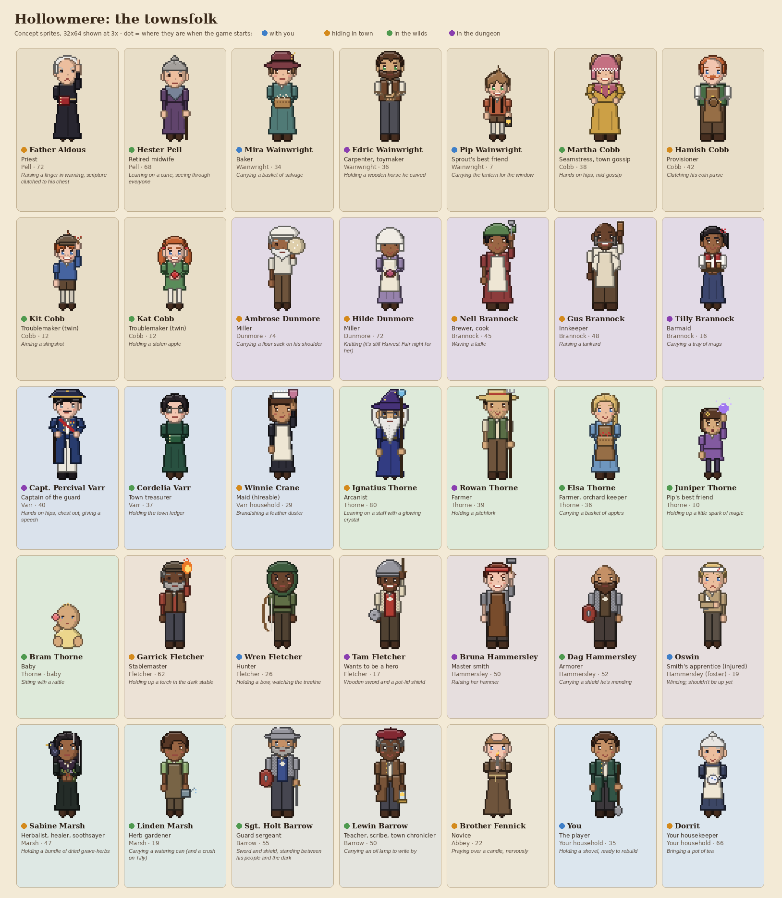

| | Name | Job | Family | Age | Look | Doing | At the start |
|---|---|---|---|---|---|---|---|
|  | **Father Aldous** | Priest | Pell | 72 | gaunt, white fringe of hair, black cassock and white collar | raising a finger in warning, scripture clutched to his chest | hiding in town |
| 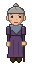 | **Hester Pell** | Retired midwife | Pell | 68 | grey topknot, plum dress, blue-grey shawl | leaning on a cane, seeing through everyone | in the wilds |
|  | **Mira Wainwright** | Baker | Wainwright | 34 | light brown low bun, plain teal dress, felt hat with a wheat sprig (outdoors) | carrying a basket of salvage | with you |
|  | **Edric Wainwright** | Carpenter, toymaker | Wainwright | 36 | dark brown hair parted in the middle, short beard, green eyes, leather vest, rolled sleeves | holding a wooden horse he carved | in the dungeon |
|  | **Pip Wainwright** | Sprout's best friend | Wainwright | 7 | messy light brown hair (Mira), green eyes (Edric), rust tunic, suspenders | carrying the lantern for the window | with you |
| 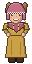 | **Martha Cobb** | Seamstress, town gossip | Cobb | 38 | light brown curls, rose bonnet, mustard dress, tape measure round her neck | hands on hips, mid-gossip | in the wilds |
| 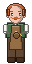 | **Hamish Cobb** | Provisioner | Cobb | 42 | ginger handlebar moustache, big belly, green waistcoat, shop apron | clutching his coin purse | hiding in town |
|  | **Kit Cobb** | Troublemaker (twin) | Cobb | 12 | ginger, freckles, flat cap, blue tunic | aiming a slingshot | in the wilds |
|  | **Kat Cobb** | Troublemaker (twin) | Cobb | 12 | ginger pigtails with red ribbons, freckles, green dress | holding a stolen apple | in the wilds |
| 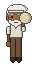 | **Ambrose Dunmore** | Miller | Dunmore | 74 | white beard, floppy miller's cap, everything dusted in flour | carrying a flour sack on his shoulder | hiding in town |
| 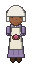 | **Hilde Dunmore** | Miller | Dunmore | 72 | white linen coif, lavender dress, apron | knitting (it's still Harvest Fair night for her) | hiding in town |
| 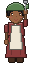 | **Nell Brannock** | Brewer, cook | Brannock | 45 | green kerchief, red dress, rolled sleeves, apron | waving a ladle | hiding in town |
| 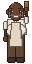 | **Gus Brannock** | Innkeeper | Brannock | 48 | bald, big grey mutton chops, rolled sleeves, apron | raising a tankard | hiding in town |
|  | **Tilly Brannock** | Barmaid | Brannock | 16 | black ponytail with a red ribbon, red bodice, navy skirt | carrying a tray of mugs | in the dungeon |
|  | **Capt. Percival Varr** | Captain of the guard | Varr | 40 | slicked black hair, thin moustache, navy coat, medals, plumed hat | hands on hips, chest out, giving a speech | in the dungeon |
| 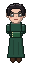 | **Cordelia Varr** | Town treasurer | Varr | 37 | neat black updo, spectacles, high-collared green dress | holding the town ledger | in the wilds |
|  | **Winnie Crane** | Maid (hireable) | Varr household | 29 | dark bob, frilled maid's cap, black dress, white apron | brandishing a feather duster | hiding in town |
|  | **Ignatius Thorne** | Arcanist | Thorne | 80 | wild white hair, long beard, spectacles, starry robe, pointed hat | leaning on a staff with a glowing crystal | hiding in town |
| 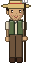 | **Rowan Thorne** | Farmer | Thorne | 39 | straw hat, stubble, green vest, rolled sleeves | holding a pitchfork | in the dungeon |
| 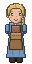 | **Elsa Thorne** | Farmer, orchard keeper | Thorne | 36 | blonde braid over her shoulder, light blue dress, brown apron | carrying a basket of apples | in the wilds |
|  | **Juniper Thorne** | Pip's best friend | Thorne | 10 | dark bob with a star clip, purple dress | holding up a little spark of magic | in the wilds |
|  | **Bram Thorne** | Baby | Thorne | baby | wisp of blonde hair, yellow romper | sitting with a rattle | in the wilds |
| 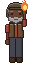 | **Garrick Fletcher** | Stablemaster | Fletcher | 62 | grey beard, flat cap, red shirt, leather vest | holding up a torch in the dark stable | hiding in town |
| 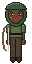 | **Wren Fletcher** | Hunter | Fletcher | 26 | green hood, olive tunic, quiver on her back | holding a bow, watching the treeline | with you |
| 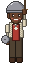 | **Tam Fletcher** | Wants to be a hero | Fletcher | 17 | a cooking pot for a helmet, padded vest | wooden sword and a pot-lid shield | in the dungeon |
| 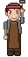 | **Bruna Hammersley** | Master smith | Hammersley | 50 | red bandana, short auburn hair, bare forearms, leather apron | raising her hammer | in the dungeon |
|  | **Dag Hammersley** | Armorer | Hammersley | 52 | bald, full dark beard, mail shirt | carrying a shield he's mending | in the wilds |
| 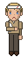 | **Oswin** | Smith's apprentice (injured) | Hammersley (foster) | 19 | blond, head bandaged, arm in a sling | wincing; shouldn't be up yet | with you |
| 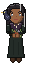 | **Sabine Marsh** | Herbalist, healer, soothsayer | Marsh | 47 | long black hair with a white streak, pale grey eyes, near-black dress, bone charms, a crow named Parson | holding a bundle of dried grave-herbs | hiding in town |
| 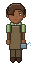 | **Linden Marsh** | Herb gardener | Marsh | 19 | long fringe over one eye, pale green shirt, garden apron | carrying a watering can (and a crush on Tilly) | in the wilds |
|  | **Sgt. Holt Barrow** | Guard sergeant | Barrow | 55 | kettle helmet, grey beard, mail and a blue town tabard | sword and shield, standing between his people and the dark | in the wilds |
| 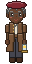 | **Lewin Barrow** | Teacher, scribe, town chronicler | Barrow | 50 | wine beret, spectacles, long brown coat | carrying an oil lamp to write by | in the wilds |
|  | **Brother Fennick** | Novice | Abbey | 22 | tonsure, brown habit with a rope belt | praying over a candle, nervously | hiding in town |
|  | **You** | The player | Your household | 35 | good green coat over a waistcoat (customisable later) | holding a shovel, ready to rebuild | with you |
|  | **Dorrit** | Your housekeeper | Your household | 66 | white topknot, navy dress, lace collar, apron | bringing a pot of tea | hiding in town |
